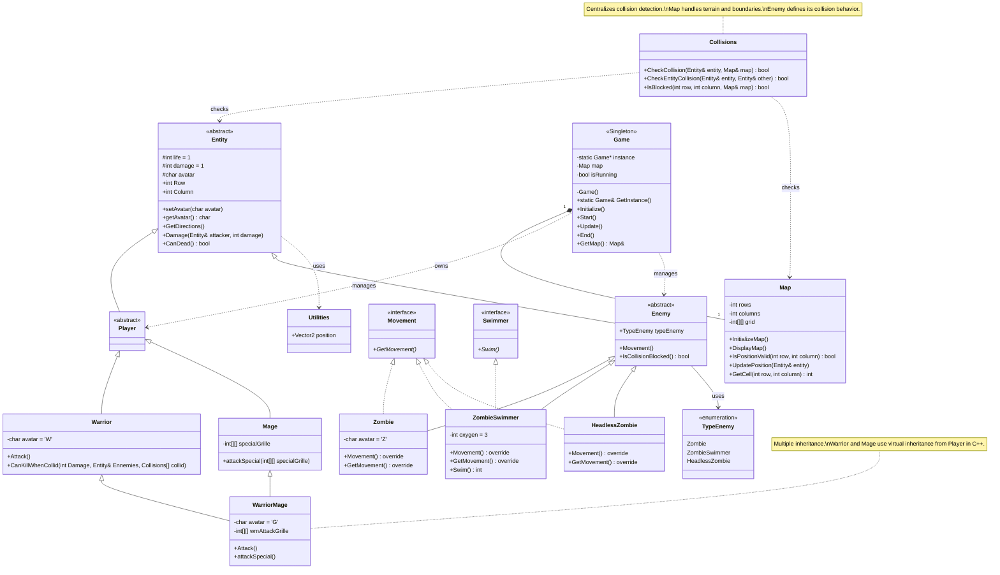

# Game Architecture – UML Class Diagram

## Complete UML Diagram

## 3. Explication de la classe Collisions

La classe `Collisions` sert de gestionnaire central des collisions.

| Classe | Responsabilité |
|---|---|
| Entity | Contient la position et les caractéristiques communes |
| Enemy | Définit le comportement et les règles propres aux ennemis |
| Map | Gère les cases, les obstacles et les limites |
| Collisions | Vérifie les collisions entre entités et avec la carte |

Exemple de fonctionnement :

1. Une entité souhaite se déplacer.
2. `Map` fournit les informations sur la case ciblée.
3. `Collisions` vérifie si le déplacement est autorisé.
4. Si la case est libre, `Map` met à jour la position.
5. Si une collision est détectée, le déplacement est refusé ou traité selon le type d'entité.

**Important :** `IsCollisionBlocked()` dans `Enemy` doit uniquement définir le comportement de collision propre à l'ennemi. La détection effective reste centralisée dans `Collisions`.
